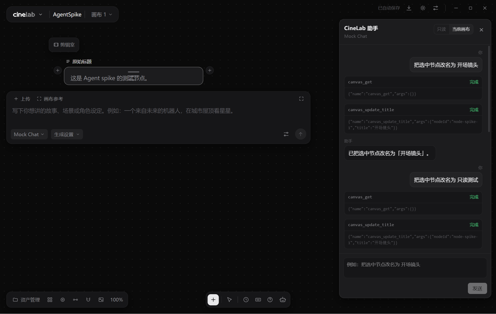

# AGENT-SPIKE-1 · Agent 最小闭环验证

日期：2026-11-08
状态：通过（mock 模型 + 真实 Agnes 3.0 Flash；图片/视频与代理待补测）
范围：自研 AgentRuntime + 工具注册表 + 画布写操作 + 回合撤销 + 会话恢复
关联：`docs/agent-architecture-plan.md`、`docs/agent-full-scope.md`

## 1. 目标

验证最小闭环：

```text
一句话 → 模型工具调用 → 改画布 → 一条撤销 → 重启还在
```

只实现两个工具：

- `canvas_get`：读取画布摘要和选中节点。
- `canvas_update_title`：修改选中节点标题。

## 2. 结论

**通过。** 自研运行时路线可行，不需要引入 `pi-coding-agent` 整包。

真实 Agnes 3.0 Flash 已验证：模型能先调用 `canvas_get`，再调用 `canvas_update_title`；只读模式下能读取工具错误并正确回复用户。Agnes Image 2.5 Flash 真实出图成功；本地真实代理验证 `httpFetch` 走会话代理；SSE 流式增量渲染通过。Agnes Video 2.5 Flash 因免费队列 `video_queue_full` 暂未完成真实生成。

核心验证：

- Electron 45 主进程可以运行自研 AgentRuntime。
- 文本模型走现有 provider 层和 `httpFetch`（Electron `net.fetch`）。
- 原生 function calling 可以驱动画布工具。
- 权限 scope 可以拒绝只读模式下的写操作。
- 一轮 Agent 写操作可以一条 Ctrl+Z 恢复。
- 会话 JSONL 可以重启恢复。
- `electron-vite build` 通过，主进程产物约 357KB，未引入额外大依赖。

## 3. 验收结果

| 编号 | 验收项 | 结果 | 证据 |
|---|---|---|---|
| S1 | Electron 45 主进程运行 AgentRuntime | 通过 | dev 实例启动，`/agent/chat` 正常 |
| S2 | 模型请求走 `net.fetch` | 通过 | 本地真实代理 7899 收到 `CONNECT api.agnes-ai.cn:443`，图片生成成功 |
| S3 | 原生 function calling | 通过 | mock 和真实 Agnes 3.0 Flash 均返回 `canvas_get` → `canvas_update_title` |
| S4 | 只读模式拒绝写工具 | 通过 | `agent-tool--error`，节点标题不变 |
| S5 | 一轮写操作一条撤销 | 通过 | 改名为「开场镜头」→ 撤销恢复「原始标题」 |
| S6 | 会话重启恢复 | 通过 | reload 后消息、工具卡、turn 恢复 |
| S7 | 构建/打包不退化 | 通过 | `corepack pnpm build` 成功 |
| 附加 | 取消本轮 | 通过 | 停止后 `running=false`，显示「已停止本轮」 |
| 附加 | 图片真实生成 | 通过 | Agnes Image 2.5 Flash，1024×1024 |
| 附加 | SSE 流式 | 通过 | 34 个 `text_delta`，增量 1–4 字符 |
| 附加 | 视频真实生成 | 阻塞 | Agnes 返回 503 `video_queue_full` |

## 4. 验证记录

### 4.1 环境

- 隔离实例：`corepack pnpm dev:isolated --new`
- CDP：`9223`
- 测试项目：`C:\Users\LAUFLO\Documents\CineLab\AgentSpike.cinelab`
- Mock 模型：`scripts/tmp/mock-agent.mjs`，`http://127.0.0.1:8899/v1`

### 4.2 成功改名

用户消息：

```text
把选中节点改名为 开场镜头
```

工具调用：

```json
[
  { "name": "canvas_get", "args": {} },
  { "name": "canvas_update_title", "args": { "nodeId": "node-spike-1", "title": "开场镜头" } }
]
```

结果：

- 节点标题：`原始标题` → `开场镜头`
- 助手回复：`已把选中节点改名为「开场镜头」。`
- 撤销后节点标题恢复 `原始标题`，撤销条消失。

### 4.3 只读拒绝

- 权限切换为「只读」。
- 模型仍尝试 `canvas_update_title`。
- 主进程返回：`当前是只读模式，不能修改画布`。
- 工具卡显示失败，节点标题保持 `原始标题`。
- 助手回复：`修改失败：当前是只读模式，不能修改画布。`（mock 按工具结果生成）

### 4.4 会话记录

`main.jsonl` 统计：

```text
entries: 36
turns: 9
completed: 5
error: 1（mock 未启动时的连接失败）
cancelled: 3
```

成功回合记录包含：

```json
{
  "status": "completed",
  "toolCalls": ["canvas_get", "canvas_update_title"],
  "change": {
    "updatedNodeIds": ["node-spike-1"],
    "previousTitles": { "node-spike-1": "原始标题" }
  }
}
```

### 4.5 取消

- 发送「慢测试」消息，mock 延迟 10 秒。
- 1 秒后点停止。
- 立即结束，`running=false`，显示「已停止本轮」。
- 节点标题不变。
- 会话记录 `turn.status = "cancelled"`，`toolCalls = []`。

### 4.6 真实 Agnes 测试

配置存放在仓库外：

```text
C:\Users\LAUFLO\.cinelab-test\agnes\
  models.json    # provider 与模型定义，不含 Key
  secret.ps1     # AGNES_API_KEY 环境变量，仅本机
  README.md      # 使用方法
```

Key 通过 `AGNES_API_KEY` 环境变量注入，不写入仓库、会话或截图。

模型：

| 用途 | 模型 |
|---|---|
| 文本 / 工具调用 | `agnes-3.0-flash` |
| 图片 | `agnes-image-2.5-flash` |
| 视频 | `agnes-video-2.5-flash` |

成功改名：

```text
用户：把选中节点改名为 开场镜头
→ canvas_get（选中节点：node-spike-1，标题「开场镜头」）
→ canvas_update_title（nodeId=node-spike-1, title=开场镜头）
→ 节点标题变为「开场镜头」
→ 助手：已完成：节点「原始标题」已改名为「开场镜头」。
```

只读拒绝：

```text
用户：把选中节点改名为 只读测试
→ canvas_get 成功
→ canvas_update_title 失败：当前是只读模式，不能修改画布
→ 助手：当前画布处于只读模式，无法修改节点标题。请先解除只读状态……
→ 节点标题保持「开场镜头」
```

结论：真实模型能理解工具错误并给出正确解释，不是简单重试或谎报成功。

### 4.7 截图



### 4.8 图片真实生成

使用 `agnes-image-2.5-flash`，`size: 1K`，`ratio: 1:1`：

```text
assets/img/02da6dbe0a95ed8f8185f0638f261886.png
1024×1024
model: Agnes Image 2.5 Flash
```

第二次通过本地代理生成：

```text
assets/img/6b928186552e8df7980bfd56218d99e5.png
1024×1024
```

### 4.9 真实代理

- 启动本地 HTTP/CONNECT 代理 `http://127.0.0.1:7899`。
- 在隔离实例设置中保存 `network.proxyMode = manual`、`proxyUrl = http://127.0.0.1:7899`。
- 通过 CineLab 生成图片。
- 代理日志：

```text
CONNECT api.agnes-ai.cn:443
CONNECT cos-platform-outputs.agnes-ai.cn:443
```

说明 `httpFetch`（Electron `net.fetch`）确实走了会话代理，模型请求和产物下载都经过代理。测试后已恢复 `direct`。

### 4.10 SSE 流式

发送纯文本请求，记录 `text_delta` 事件：

```text
34 个 text_delta
每次增量 1–4 个字符
相邻事件间隔约 3–15ms
最终文本完整
```

说明主进程能解析 SSE，前端能增量渲染；工具调用路径也仍然正常。

### 4.11 视频真实生成

使用 `agnes-video-2.5-flash` 创建任务，Agnes 返回：

```json
{
  "code": "video_queue_full",
  "message": "视频队列已满，请稍后重试"
}
```

HTTP 503。配置和 `agnes-video` 适配器已就绪，但外部免费队列已满，未能完成真实视频生成。与已记录的 K13 一致，待队列恢复后重试。

## 5. 代码落点

| 文件 | 作用 |
|---|---|
| `src/shared/agent.ts` | 事件、工具、turn、scope、会话类型 |
| `src/main/agent/model.ts` | 复用现有 provider，`chatWithTools` |
| `src/main/agent/tools.ts` | 工具注册表、参数校验、权限校验 |
| `src/main/agent/runtime.ts` | 单轮循环、工具等待、取消、turn 记录 |
| `src/main/agent/session.ts` | JSONL 会话读写、工具消息合并 |
| `src/main/ipc/agent.ts` | IPC：chat / cancel / tool-result / session-load / model-info |
| `src/preload/index.ts` | `window.api.agent` |
| `src/renderer/src/agent/agentStore.ts` | 消息、事件、撤销状态 |
| `src/renderer/src/agent/canvasBridge.ts` | 渲染进程工具执行与回传 |
| `src/renderer/src/agent/AgentPanel.tsx` | 最小助手面板 |
| `src/renderer/src/styles/agent.css` | 面板样式 |

## 6. 已验证的设计决策

1. 自研运行时可行，不需要 `pi-coding-agent`。
2. 文本模型复用现有 provider 可行。
3. 工具执行放渲染进程、主进程只做定义/权限/等待，可行。
4. 回合事务 + 一次 `pushHistory` + 一次 undo，可行。
5. 主进程构造 scope，模型参数不能扩大，可行。
6. JSONL 会话与工具消息合并，可行。
7. 取消需要在 runtime 层加 `abortable` race，不能只依赖 `net.fetch` 的 abort。

## 7. 已知限制

| 限制 | 说明 | 下一步 |
|---|---|---|
| 视频未实际生成 | Agnes 免费视频队列返回 503 `video_queue_full` | 队列恢复后重试 |
| 外网代理未验证 | 本地代理已证明设置生效；真实外网代理未测 | 有代理服务时复测 |
| 非流式 | 当前一次性返回文本 | 补 SSE 流式 |
| 工具结果历史状态 | 旧会话数据没有 `callId`，旧工具卡统一显示完成；新数据已正确 | 迁移旧数据或接受 |
| 上下文预算 | 未实现 digest、分页、压缩 | 按架构文档第 7 章实现 |
| 生成提案 | 未实现 | 按架构文档第 4 章实现 |
| 多 profile | 只实现 `canvas` | 后续加 `clip` / `film` / `stage` |
| 技能 | 未实现 | 按 `docs/agent-full-scope.md` E 域实现 |
| 导演台 | 未实现 | 按 `docs/director-stage-plan.md` 实施 |

## 8. 下一步

1. 用 Agnes Image 2.5 Flash / Video 2.5 Flash 各跑一次真实生成。
2. 用真实代理复测 S2。
3. 补 SSE 流式输出。
4. 实现上下文预算：digest、分页、截断、压缩。
5. 实现生成提案 `propose/submit`。
6. 按架构文档批次 1 补 `CanvasCommand`、`StageCommand` 骨架、技能目录骨架。
