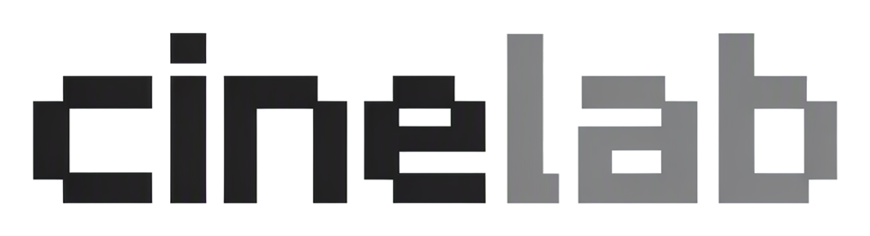

  <picture>
    <source media="(prefers-color-scheme: dark)" srcset="docs/brand/readme-wordmark-dark.png">
    
  </picture>

  A local-first AI creative workspace · infinite canvas + CineBot + clip studio + director stage + frame-by-frame film study

  
  
  

  <a href="README.md">简体中文</a> | English

  <a href="https://github.com/LAUFLO/CineLab/releases/latest">Download</a>
  ·
  <a href="docs/README.md">Docs</a>

## What is CineLab

CineLab is a local-first AI creative workspace. Image, video, audio and text generation all happen on one infinite canvas, and nodes, edges, assets, generation history and agent sessions stay inside your own `.cinelab` project folder.

The creative process is split into four workspaces: the infinite canvas for assets and generation, Clip Studio for the timeline, Director Stage for 3D previs, and frame-by-frame film study for shot breakdown. CineBot operates all four in natural language, and can register model operations as proposals that only run after you confirm.

CineLab does not lock you to a model vendor. It works with any OpenAI-compatible endpoint, self-hosted services and proxies, and ships adapters for Kling, Volcengine Ark, MiniMax, Vidu and custom HTTP templates.

The canvas interaction is modelled after LibTV's infinite canvas, with the goal of matching its feel while keeping the model layer open.

## Core capabilities

### Infinite canvas

- Free-form nodes, drag-to-connect edges, right-side `+` to start generation
- Multiple projects and canvases, autosave, crash recovery and project covers
- Groups, storyboard groups, 2K stitching and a version stack
- Node toolbar: grids, multi-angle, relighting, portraits, matting, free crop and 3D lighting

### CineBot

- Create, move, connect and delete nodes, edit titles and text in natural language
- Covers the canvas, Clip Studio, Director Stage and film study
- Generation proposals only submit after confirmation, so nothing is charged up front
- Permission modes, turn undo, project-local sessions and a three-level skill directory

### Clip Studio

- Multi-track timeline for video, audio, subtitles and images
- Trim, split, snap, speed, volume, fades and transitions
- Auto rough cut: remove silence, split by shot, beat markers and beat splitting
- Local Whisper subtitles, ffmpeg export written back to the canvas

### Director Stage

- three.js 3D scene: mannequins, primitives, planes, crowd arrays and local glTF
- Multiple cameras, keyframed camera moves, shot duration and aspect ratio
- Object position, rotation, scale, pose, color, visibility and background
- Previs export to video and back to the canvas

### Frame-by-frame film study

- Video node → film-study node → storyboard group and sheet created automatically
- Shot detection or fixed-interval splitting
- AI descriptions for shot size, camera, movement, lighting, image and prompt
- Section editing, embedded subtitle extraction, Markdown and study-package export

### Local media

- Depth-based motion capture (VDA Small) with output matching the input aspect ratio
- Frame extraction, crop, audio/video separation, subtitle removal and shot regeneration
- Matting, outpainting, layer separation, grid split and storyboard stitching
- Models and runtimes download on demand instead of shipping in the installer

## Download and install

Download the latest release from [GitHub Releases](https://github.com/LAUFLO/CineLab/releases/latest):

| Platform | Recommended file | Requirements |
|---|---|---|
| Windows | `CineLab-0.1.1-x64.exe` | Windows 10 / 11 x64 |
| macOS | `CineLab-0.1.1-arm64.dmg` | macOS 12+, Apple Silicon |

### Windows

- The installer is unsigned. If SmartScreen appears, choose "More info" → "Run anyway".
- Project data stays in the folder you choose; settings live in `%APPDATA%\CineLab`.
- Uninstall from Windows Settings → Apps → CineLab.

### macOS

- The package is unsigned and not notarized. On first launch, right-click → Open, or allow it in System Settings → Privacy & Security.
- Depth capture, vision enhancement and local subtitle runtimes are downloaded per platform.
- Auto-update is disabled in the first macOS release; download new versions manually.
- Settings live in `~/Library/Application Support/CineLab`.

Verify downloads against `SHA256SUMS.txt` on the release page.

## First run

1. Open CineLab and create a project in the project center
2. Go to Settings → Model providers and choose a preset, or enter a Base URL / API key manually
3. Return to the canvas, double-click empty space or click the right-side `+` to create your first node
4. When you need local subtitles, depth capture or vision enhancement, download the component when prompted

## Feedback

Report bugs and feature requests in [GitHub Issues](https://github.com/LAUFLO/CineLab/issues). Please search for an existing report first.

Do not open a public issue for security problems. Follow [SECURITY.md](SECURITY.md) instead.

## Documentation

Most design documents are currently written in Chinese.

- [Document index](docs/README.md)
- [Architecture](docs/architecture.md)
- [Model configuration](docs/models.md)
- [UI specification](docs/ui-spec.md)
- [CineBot capabilities](docs/agent-capabilities.md)
- [Clip Studio](docs/clip-studio-plan.md) · [Director Stage](docs/director-stage-plan.md) · [Film study](docs/film-study-plan.md)

## Development

Requirements, commands, project layout, branch policy and PR checks are documented in [CONTRIBUTING.md](CONTRIBUTING.md).

## Contributing

The project is evolving quickly; issues and pull requests are welcome. For larger changes, open an issue first to align on the approach, and read [CONTRIBUTING.md](CONTRIBUTING.md) plus the [branch policy](docs/branch-policy.md) before submitting.

## License

[MIT](LICENSE)
