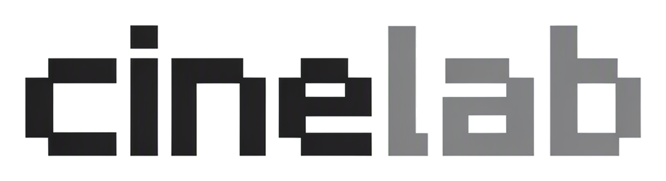

<p align="center">
  <picture>
    <source media="(prefers-color-scheme: dark)" srcset="docs/brand/readme-wordmark-dark.png">
    
  </picture>
</p>

<p align="center">
  本地运行的 AI 创作工作台 · 无限画布 + CineBot + 剪辑室 + 导演台 + 逐帧拉片 · 数据存在你自己的硬盘上
</p>

<p align="center">
  <a href="LICENSE"></a>
  
  
  
</p>

## 简介

CineLab 是一个面向 AIGC 创作者的本地创作工作台。图片、视频、音频、文本生成都在同一张无限画布上完成，CineBot 负责用自然语言操作画布、剪辑室、导演台和拉片数据，素材、节点、连线、生成历史和会话都保存在本地 `.cinelab` 项目文件夹里。

与常见的云端创作工具不同，CineLab 不绑定模型供应商：可以接入任意 OpenAI 兼容接口、自建服务、中转站，也支持可灵、火山方舟、MiniMax、Vidu 等视频服务，以及自定义 HTTP 模板。

画布交互参考 LibTV 的无限画布产品，目标是做到体验一致、能力更开放。

## 功能

### 画布与项目

- **无限画布**：节点自由摆放，拖线连接上下游，右侧 `+` 发起生成
- **多项目 / 多画布**：一个项目包含多个画布，支持创建、切换、重命名、删除
- **自动保存**：画布与项目元数据自动落盘，崩溃后可恢复
- **项目中心**：欢迎页展示最近项目，支持项目封面（本地图片或画布图片，1:1）
- **分组与分镜**：普通分组、分镜组、宫格排列、2K 拼接、转普通组
- **版本栈**：同一节点的多次生成可对比、回滚、继续基于历史结果生成

### CineBot

- **对话式操作**：用自然语言创建/移动/连接/删除节点，修改标题和文本，登记生成提案
- **覆盖四个空间**：画布、剪辑室、导演台、拉片
- **节点操作桥**：宫格切分、裁剪、抽帧、片段截取、分离音视频、去字幕、抠图、主体消除等操作由 UI 和 Agent 共用同一个执行器
- **生成提案**：模型类操作通过 `generation_propose` 登记，用户确认后才提交，不会先扣费
- **回合撤销**：一轮对话中的画布、时间线、场景和拉片修改各合并为一条撤销记录
- **权限与确认**：只读 / 当前空间 / 完整访问三种模式，删除、覆盖、导出等操作需要确认
- **会话与技能**：会话保存在项目内，支持历史对话、上下文压缩和三级技能目录

### 剪辑室

- **多轨时间线**：视频、音频、字幕、图片轨，片段拖拽、裁剪、切分、吸附
- **片段属性**：速度、音量、静音、透明度、淡入淡出、转场
- **自动粗剪**：删静音、按镜头切分、节拍标记、节拍切分
- **自动字幕**：本地 Whisper 转写，生成字幕片段
- **导出成片**：ffmpeg 渲染并写回画布上的剪辑室节点

### 导演台

- **3D 场景**：人物素模、基础几何体、平面、群众阵列和本地 glTF
- **机位与镜头**：多机位、机位关键帧运镜、镜头时长和画幅
- **场景编辑**：对象位置/旋转/缩放、姿势、颜色、可见性、背景
- **白模预演**：本地 three.js 渲染 + ffmpeg 导出视频，并回到画布

### 逐帧拉片

- **节点式入口**：视频节点工具栏「逐帧拉片」→ 创建拉片节点 → 自动生成分镜组和分镜表
- **自动分镜**：镜头检测或固定间隔拆分，支持 AI 描述景别、机位、运镜、光线、画面和提示词
- **拉片数据**：段落标题、时间、结构角色、画面描述、提示词、人声、音乐、备注
- **字幕与导出**：提取内嵌字幕，导出 Markdown、AI 分析包或完整拉片包
- **高级编辑**：原拉片室保留为分镜表的「高级编辑」浮层，不再是主入口

### 生成能力

- **图片**：文生图、图生图、九宫格、多角度、打光、人像、抠图、扩图
- **视频**：文生视频、图生视频、首尾帧、可灵 / 火山方舟 / MiniMax / Vidu 等适配器
- **音频**：TTS 语音合成、音乐生成
- **文本**：LLM 节点、剧本生成、提示词改写
- **任务队列**：并发限制、进度事件、取消、失败重试

### 本地媒体处理

- **深度动作捕捉**：VDA Small 视频深度图，输出比例跟随输入，组件按需下载
- **视频工具**：截取、裁切、分离音视频、抽帧、去字幕、片段重拍
- **图片工具**：自由裁剪、宫格切分、分镜拼接、抠图、扩图、图层分离
- **文件与导出**：项目打包、当前画布 PNG、选中素材 ZIP 导出

### 创作体验

- **节点工具栏**：一级操作 + 更多菜单，支持自定义常用操作
- **命令面板 / 快捷键 / 生成历史**：底部工具栏统一入口
- **深浅双主题**：黑白灰视觉体系，只通过 CSS 变量切换
- **统一 tooltip**：超出可视区域的提示会自动避让

## 技术栈

| 层 | 选择 |
|---|---|
| 桌面端 | Electron 45，无边框窗口，主进程隔离 |
| 前端 | React 19 + TypeScript 7 + Vite 8 |
| 画布 | React Flow 12（`@xyflow/react`） |
| 状态 | Zustand 5 |
| 样式 | Tailwind CSS 4 + CSS 变量（深浅双主题） |
| 校验 | Zod 4 |
| 媒体 | ffmpeg-static + ffprobe-static |
| 存储 | 项目文件夹 + JSON / JSONL，不使用 SQLite |
| Agent | 自研 AgentRuntime，OpenAI 兼容 function calling，SSE 流式 |

## 快速开始

需要 Node.js 22+（CI 使用 Node 24）和 pnpm 12。如果 `pnpm` 不在 PATH 中，先执行 `corepack enable`。

```bash
corepack pnpm install
corepack pnpm dev
```

启动后在欢迎页新建项目，进入设置配置模型供应商和 API Key，然后回到画布开始创作。

Windows 下如果 Electron 二进制下载失败：

```powershell
$env:ELECTRON_MIRROR="https://npmmirror.com/mirrors/electron/"
node node_modules/electron/install.js
```

## 开发命令

```bash
corepack pnpm dev              # 启动 Electron + Vite
corepack pnpm dev:isolated     # 独立测试实例：独立 userData + 自动分配 CDP 端口
corepack pnpm typecheck        # 主进程 + 渲染进程类型检查
corepack pnpm test             # Vitest 单元测试
corepack pnpm build            # 生产构建
corepack pnpm dist:win         # 打包 Windows 安装包
corepack pnpm check:encryption # 检查透明加密文件与 Git blob 是否为明文
corepack pnpm models:check     # 校验 models.json
```

## 项目结构

```text
src/
├─ main/       主进程：窗口、IPC、项目读写、Provider、任务队列、Agent、剪辑导出、导演台渲染、组件下载
│  ├─ agent/          AgentRuntime、工具注册、能力目录、会话、技能、生成提案
│  ├─ film-study/     拉片抽帧、镜头检测、AI 分析、导出
│  ├─ stage/          导演台场景存储与白模预演
│  ├─ timeline/       时间线分析与导出
│  └─ ...
├─ preload/    contextBridge 桥接
├─ shared/     节点 / 项目 / Provider / 媒体 / Agent / 时间线 / 场景 schema 与 IPC 契约
└─ renderer/
   └─ src/
      ├─ canvas/      画布、节点、连线、工具栏、prompt bar、拉片节点
      ├─ agent/       CineBot 面板、会话状态、画布/剪辑/导演台/拉片桥
      ├─ studio/      剪辑室时间线、检查器、导出
      ├─ stage/       导演台视口、检查器、时间线
      ├─ stores/      Zustand 状态
      ├─ panels/      设置、资产库、项目中心
      ├─ components/  通用组件与品牌组件
      ├─ theme/       主题切换
      └─ styles/      CSS 变量与全局样式
```

## 文档

- [文档索引](docs/README.md)：现行文档、已实施方案、历史归档和待实施计划
- [技术架构](docs/architecture.md)：主进程架构、项目文件格式、Provider 接口、任务系统
- [界面规格](docs/ui-spec.md)：布局尺寸、节点结构、prompt bar、工具栏清单
- [CineBot 架构](docs/agent-architecture-plan.md)：AgentRuntime、工具协议、权限、确认、回合事务
- [CineBot 能力清单](docs/agent-capabilities.md)：当前工具、参数校验、确认规则和回合撤销
- [模型配置](docs/models.md)：`models.json` 格式与 Provider 配置
- [剪辑室](docs/clip-studio-plan.md)：多轨时间线、自动粗剪、字幕和导出
- [导演台](docs/director-stage-plan.md)：3D 场景、机位、镜头和白模预演
- [逐帧拉片](docs/film-study-plan.md)：节点式拉片、自动分镜、AI 描述和导出
- [后续路线图](docs/roadmap-plan.md)：当前状态、剩余 backlog 和执行顺序

## 路线图

已完成：

- [x] 无限画布、节点连线、自动保存、多项目 / 多画布
- [x] OpenAI 兼容文生图 / 图生图 / 文本 / TTS
- [x] 可灵、火山方舟、MiniMax、Vidu 视频适配器
- [x] 分组节点、分镜组、2K 拼接
- [x] 节点工具栏：九宫格、多角度、打光、人像、抠图、自由裁剪、3D 光位
- [x] 深度动作捕捉（VDA Small，组件按需下载）
- [x] 剪辑室：多轨、自动字幕、删静音、镜头/节拍切分、转场、导出
- [x] 导演台：3D 场景、机位、镜头、运镜、背景、白模预演
- [x] 逐帧拉片：自动分镜、AI 描述、段落编辑、字幕提取、导出
- [x] CineBot Phase 1–4：画布 / 剪辑 / 导演台 / 拉片工具、节点操作桥、能力目录、生成提案
- [x] Git 工作流、Vitest、GitHub Actions Windows 打包

计划中：

- [ ] 安装包进一步瘦身（ffprobe 仅保留目标平台）
- [ ] 蒙版类节点操作的 Agent 化（重绘 / 擦除 / 元素编辑）
- [ ] 拉片分析包导入（Agent 指定项目内路径）
- [ ] 导演台对象动作轨和独立灯光实体
- [ ] 真实 tokenizer、动态工具暴露和上下文预算
- [ ] Agnes 视频队列恢复后补测
- [ ] 代码签名和正式发布流程

## 贡献

项目仍在快速迭代中，欢迎提 Issue 和 PR。提交 PR 前建议先开 Issue 对齐方案。

## 协议

[MIT](LICENSE)
